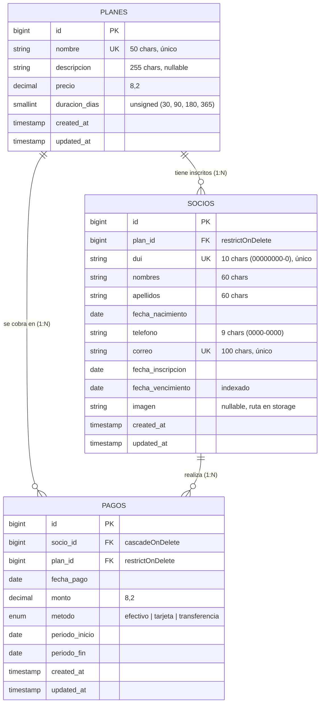
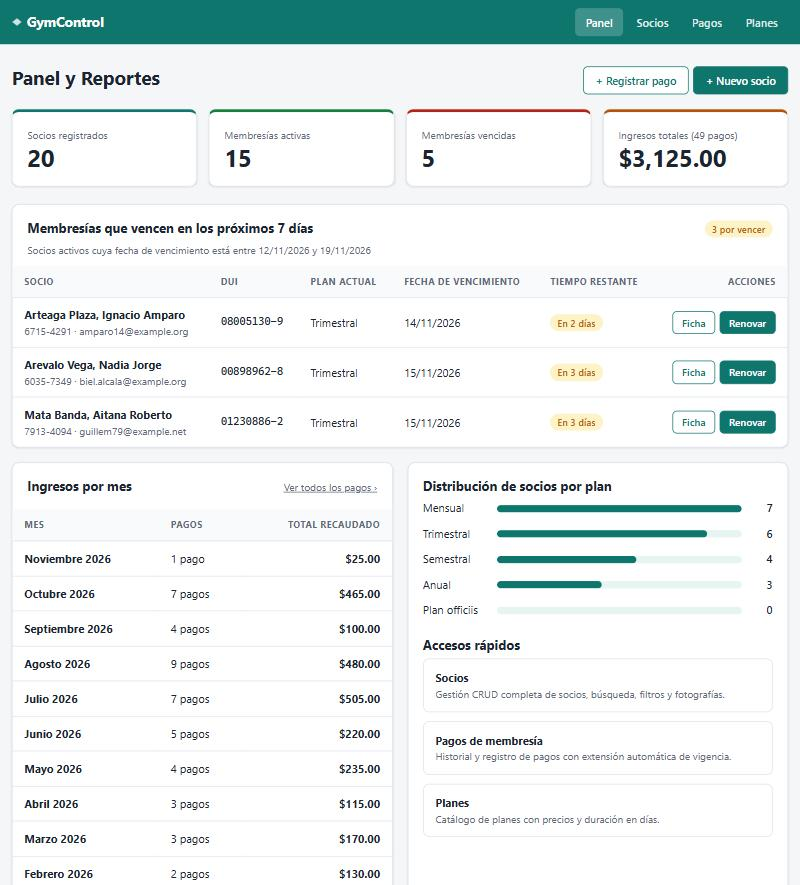
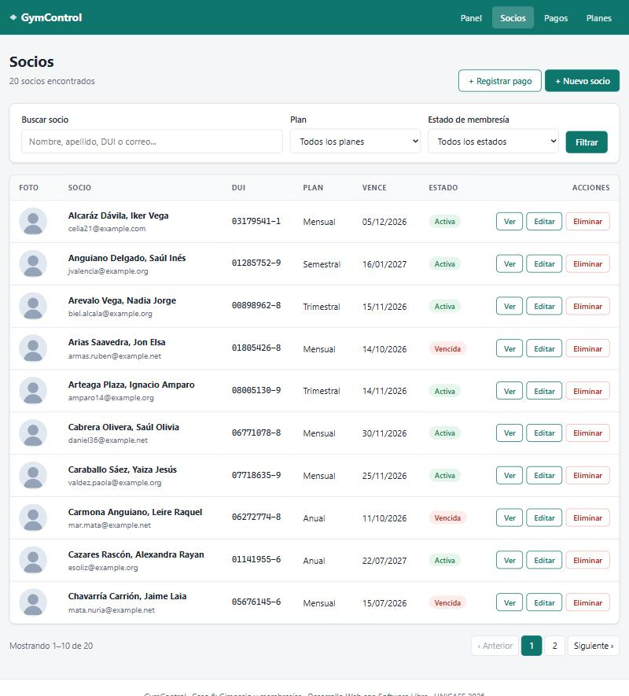
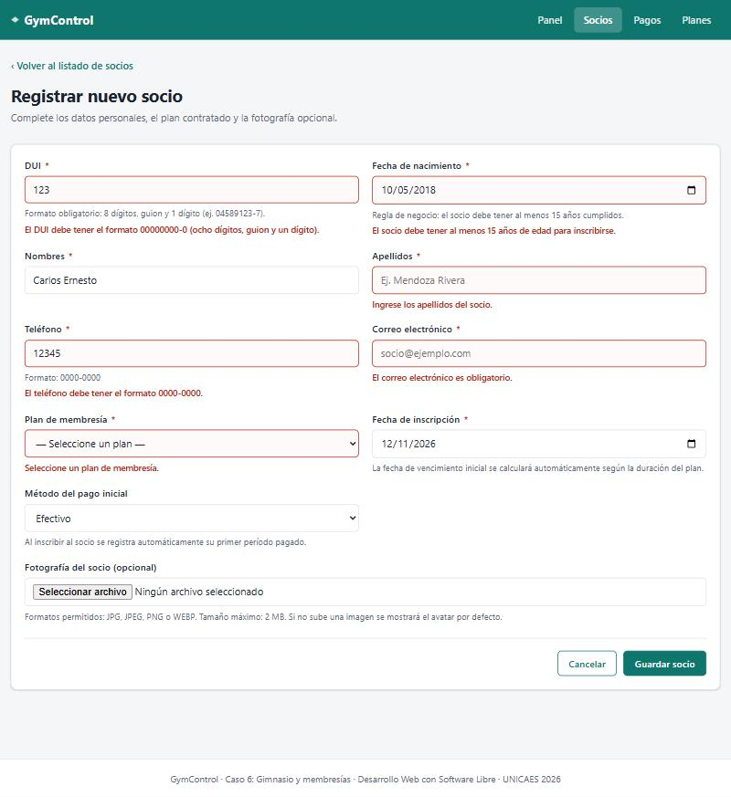
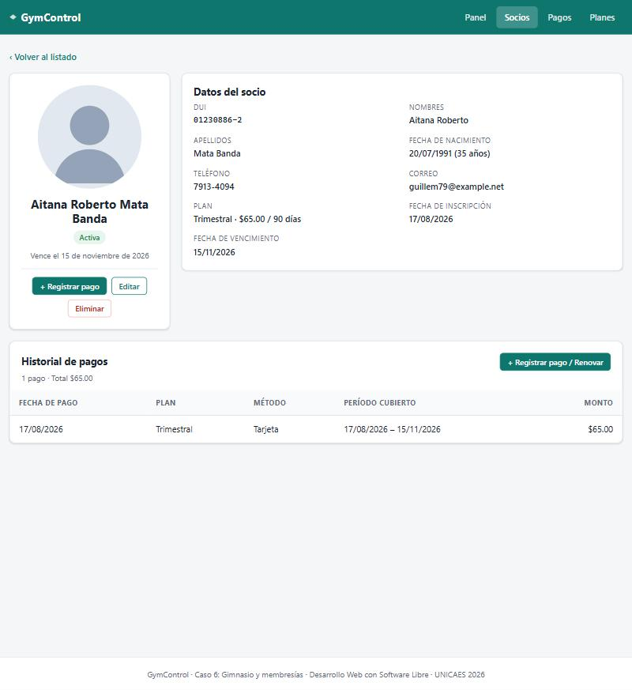
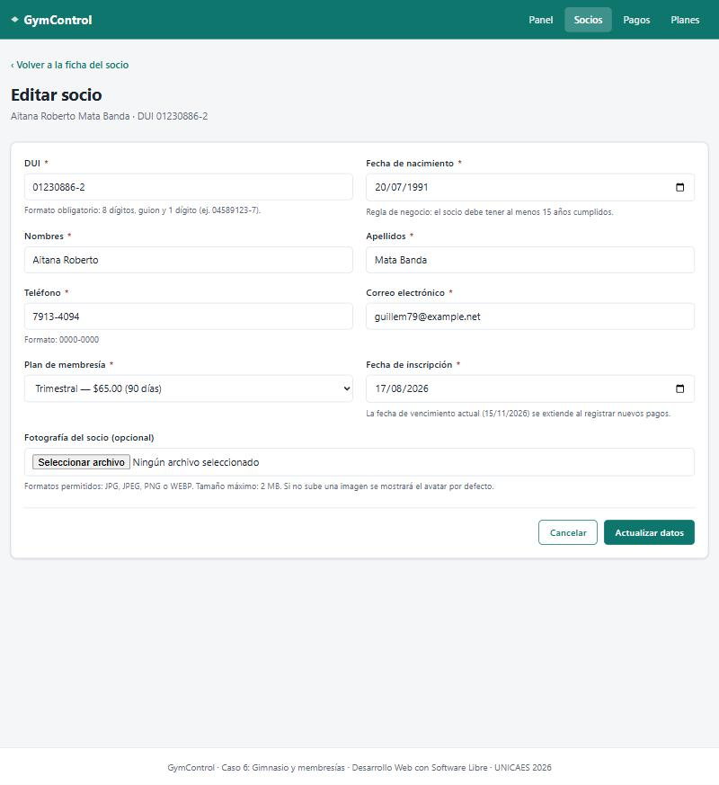
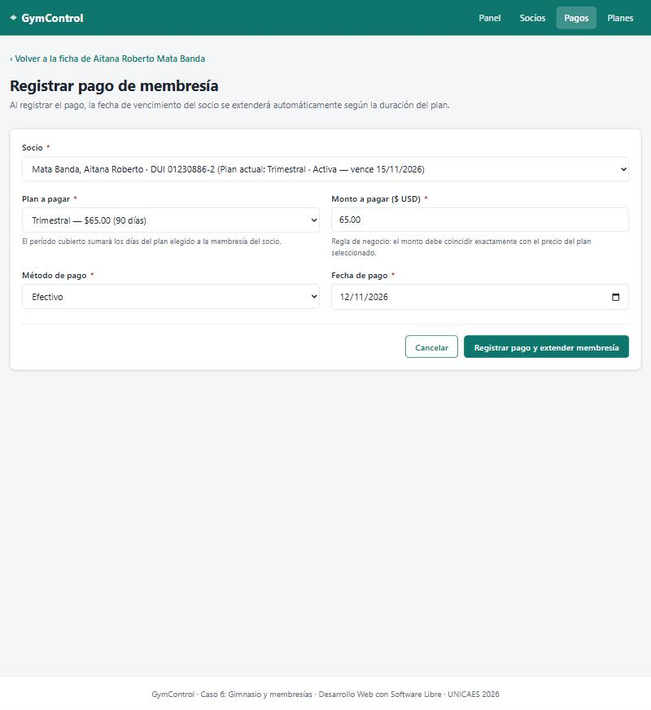
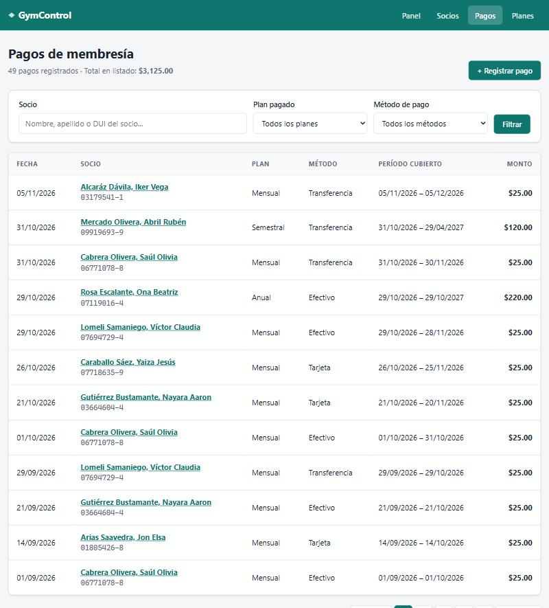

# GymControl — Sistema de Gestión de Gimnasio y Membresías

Proyecto desarrollado para la asignatura **Desarrollo Web con Software Libre** (UNICAES) utilizando **Laravel 13**.

---

## 1. Información General del Proyecto

* **Nombre del sistema:** GymControl
* **Caso de estudio asignado:** Caso 6 · Gimnasio y membresías
* **Framework y entorno:** Laravel 13.x · PHP 8.3+ · Composer 2.x
* **Motor de base de datos:** MariaDB / MySQL (`gimnasio`)
* **Versión actual:** `v2.0` (Fase 1 + Fase 2 completadas)

### Integrantes del Equipo 6

| Integrante | Usuario GitHub | Rol en Fase 1 (`v1.0`) | Rol en Fase 2 (`v2.0`) |
| :--- | :--- | :--- | :--- |
| **Luis Balcáceres** | `@balcaceres-l` | Layout común, estilos propios y parciales | Scopes de negocio en `Socio`, `Form Requests` (`StoreSocioRequest`, `UpdateSocioRequest`, `StorePagoRequest`) y estilos de formularios/filtros |
| **Denis Ademir** | `@denis2812dk` | Migraciones y modelos Eloquent con relaciones | Operaciones CRUD completas en `SocioController`, búsqueda/filtros y manejo físico de fotografías con Laravel `Storage` |
| **Mario Edgardo Villeda Alabí** | `@MarioAlabi` | Catálogo de planes, factories y seeders | Vistas Blade de registro y edición de socios (`_form`, `create`, `edit`), barra de filtros y eliminación con `@method('DELETE')` |
| **Katherinne Algarín** | `@KatherinneAlgarin` | Controladores de consulta y vistas de lectura | `PagoController`, vistas de pagos con extensión de vigencia, reporte de ingresos por mes y membresías por vencer en 7 días, y documentación final |

---

## 2. Especificaciones del Caso 6 · Gimnasio y Membresías

* **Entidad principal (`Socio` — CRUD completo):** DUI (`00000000-0`), nombres, apellidos, fecha de nacimiento, teléfono (`0000-0000`), correo electrónico, plan contratado, fecha de inscripción, fecha de vencimiento y fotografía.
* **Catálogo (`Plan`):** Planes de membresía (*Mensual*, *Trimestral*, *Semestral*, *Anual*) con precio y duración en días (`30`, `90`, `180`, `365`). Relación `1:N` con socios y pagos.
* **Entidad relacionada (`Pago`):** Historial y registro de pagos de membresía con socio, plan, fecha de pago, monto, método (`efectivo`, `tarjeta`, `transferencia`) y período cubierto (`periodo_inicio`, `periodo_fin`).
* **Imagen:** Fotografía del socio almacenada en `storage/app/public/socios` con respaldo automático a `public/img/socio-default.svg`.

---

## 3. Reglas de Negocio Implementadas (Fase 2)

Todas las reglas de negocio del **Caso 6** se validan y ejecutan desde el backend:

1. **DUI con formato `00000000-0` y único; correo válido y único:**
   * Validado en [`StoreSocioRequest`](app/Http/Requests/StoreSocioRequest.php) y [`UpdateSocioRequest`](app/Http/Requests/UpdateSocioRequest.php) mediante expresiones regulares (`regex:/^\d{8}-\d$/`) y reglas `unique` en la tabla `socios` (ignorando el ID propio al editar con `Rule::unique('socios')->ignore($socioId)`).
2. **El socio debe tener al menos 15 años:**
   * Validado en el servidor con `'before_or_equal:' . today()->subYears(15)->toDateString()` sobre `fecha_nacimiento`.
3. **El monto del pago debe coincidir con el precio del plan:**
   * Validado en [`StorePagoRequest`](app/Http/Requests/StorePagoRequest.php) mediante un hook `after()` que compara el monto recibido contra `$plan->precio` en la base de datos y rechaza cualquier diferencia.
4. **Al registrar un pago, la fecha de vencimiento se extiende según la duración del plan (calculada en el servidor):**
   * En [`PagoController@store`](app/Http/Controllers/PagoController.php):
     * Si la membresía del socio está **activa**, el nuevo período inicia en su `fecha_vencimiento` actual y suma `$plan->duracion_dias` (conservando sus días vigentes).
     * Si la membresía está **vencida**, el nuevo período inicia en la `fecha_pago` y suma `$plan->duracion_dias`.
     * Todo se guarda dentro de una transacción (`DB::transaction`).
5. **Mostrar el estado de la membresía (activa o vencida) a partir de la fecha de vencimiento:**
   * Calculado dinámicamente en [`Socio::estaActiva()`](app/Models/Socio.php) y [`Socio::estadoMembresia()`](app/Models/Socio.php), y representado visualmente mediante el parcial [`resources/views/partials/estado.blade.php`](resources/views/partials/estado.blade.php).

---

## 4. Diagrama Entidad-Relación (ER)



---

## 5. Cambios Realizados Respecto a la Fase 1

* **Continuidad de Base de Datos:** No fue necesario modificar ni crear nuevas migraciones, ya que el esquema diseñado en la Fase 1 (`planes`, `socios` y `pagos` con `periodo_inicio`, `periodo_fin`, `fecha_vencimiento` e `imagen`) cubrió íntegramente los requerimientos de la Fase 2.
* **CRUD Completo de Socios (`SocioController`):** Se implementaron los métodos `create`, `store`, `edit`, `update` y `destroy`, además de búsqueda por texto y filtros combinables por plan y estado de membresía en `index`.
* **Manejo de Imágenes con `Storage`:** Carga de fotografías en el disco `public` (`storage/app/public/socios`), validación de formato (`jpg, jpeg, png, webp`) y peso máximo de `2 MB`, y eliminación física de la imagen anterior al actualizar o eliminar un socio para evitar archivos huérfanos.
* **Módulo de Pagos (`PagoController`):** Listado general filtrable y formulario de registro de pagos que valida el precio del plan y extiende automáticamente la vigencia del socio.
* **Panel de Reportes (`PanelController`):** Se añadieron consultas agregadas (`SUM`, `COUNT`, `GROUP BY`) para mostrar **socios activos y vencidos**, **ingresos por mes** y el listado de **membresías que vencen en los próximos 7 días**.

---

## 6. Instrucciones de Instalación y Puesta en Marcha

1. **Clonar el repositorio e instalar dependencias:**
   ```bash
   git clone https://github.com/balcaceres-l/proyecto-final-laravel-equipo6.git
   cd proyecto-final-laravel-equipo6
   composer install
   ```

2. **Configurar el archivo `.env` y la llave de aplicación:**
   ```bash
   cp .env.example .env
   php artisan key:generate
   ```

3. **Configurar la conexión a MariaDB / MySQL en `.env`:**
   ```env
   DB_CONNECTION=mariadb
   DB_HOST=127.0.0.1
   DB_PORT=3306
   DB_DATABASE=gimnasio
   DB_USERNAME=root
   DB_PASSWORD=
   ```

4. **Crear el enlace simbólico para las fotografías de socios:**
   ```bash
   php artisan storage:link
   ```

5. **Ejecutar migraciones y seeders:**
   ```bash
   php artisan migrate:fresh --seed
   ```

6. **Iniciar el servidor local:**
   ```bash
   php artisan serve
   ```

---

## 7. Índice de Etiquetas `[CONCEPTO]` en el Código

| Etiqueta | Descripción | Archivos donde se aplica |
| :--- | :--- | :--- |
| `[MIGRACION]` | Definición de esquema, llaves únicas e índices | `database/migrations/2026_11_10_000001_create_planes_table.php`<br>`database/migrations/2026_11_10_000002_create_socios_table.php`<br>`database/migrations/2026_11_10_000003_create_pagos_table.php` |
| `[RELACION]` | Llaves foráneas (`constrained`) y relaciones Eloquent (`hasMany`, `belongsTo`) | `app/Models/Plan.php`<br>`app/Models/Socio.php`<br>`app/Models/Pago.php` |
| `[ENCAPSULAMIENTO]` | `$fillable`, `casts()` y atributos calculados (`Attribute`) | `app/Models/Plan.php`<br>`app/Models/Socio.php`<br>`app/Models/Pago.php` |
| `[INYECCION-DEPENDENCIAS]` | *Route Model Binding* e inyección de `FormRequest` | `app/Http/Controllers/SocioController.php` |
| `[CRUD-READ]` | Consultas paginadas, filtros, eager loading y reportes agregados | `app/Http/Controllers/SocioController.php` (`index`, `show`)<br>`app/Http/Controllers/PagoController.php` (`index`)<br>`app/Http/Controllers/PanelController.php` (`index`) |
| `[CRUD-CREATE]` | Creación de socios y registro de pagos en transacciones | `app/Http/Controllers/SocioController.php` (`create`, `store`)<br>`app/Http/Controllers/PagoController.php` (`create`, `store`) |
| `[CRUD-UPDATE]` | Edición y actualización de datos de socios | `app/Http/Controllers/SocioController.php` (`edit`, `update`) |
| `[CRUD-DELETE]` | Eliminación de socios con confirmación y limpieza de archivo | `app/Http/Controllers/SocioController.php` (`destroy`)<br>`resources/views/socios/index.blade.php`<br>`resources/views/socios/show.blade.php` |
| `[VALIDACION]` | Validación en servidor con `Form Requests`, `old()` y `@error` en español | `app/Http/Requests/StoreSocioRequest.php`<br>`app/Http/Requests/UpdateSocioRequest.php`<br>`app/Http/Requests/StorePagoRequest.php`<br>`resources/views/socios/_form.blade.php` |
| `[REGLA-NEGOCIO]` | Reglas del Caso 6 (DUI, edad $\ge 15$, monto igual al plan, extensión de vencimiento y estado activo/vencido) | `app/Models/Socio.php`<br>`app/Http/Requests/StoreSocioRequest.php`<br>`app/Http/Requests/StorePagoRequest.php`<br>`app/Http/Controllers/SocioController.php`<br>`app/Http/Controllers/PagoController.php` |
| `[ALMACENAMIENTO]` | Subida de fotos a `Storage::disk('public')` y eliminación de fotos anteriores | `app/Http/Controllers/SocioController.php` (`store`, `update`, `destroy`) |
| `[SEGURIDAD]` | Directivas `@csrf`, `@method('PUT')` y `@method('DELETE')` | `resources/views/socios/create.blade.php`<br>`resources/views/socios/edit.blade.php`<br>`resources/views/socios/index.blade.php`<br>`resources/views/socios/show.blade.php`<br>`resources/views/pagos/create.blade.php` |

---

## 8. Capturas de Pantalla del Sistema

> Capturas tomadas con el sistema en funcionamiento (`php artisan serve`) sobre la base de datos del equipo:

1. **Panel y Reportes (Ingresos por mes y membresías por vencer en 7 días):**
   
2. **Listado de Socios con Búsqueda y Filtros:**
   
3. **Formulario de Registro de Socio con Mensajes de Validación en Español:**
   
4. **Ficha de Detalle de Socio con Fotografía e Historial de Pagos:**
   
5. **Formulario de Edición de Socio:**
   
6. **Registro de Pago de Membresía y Extensión de Vencimiento:**
   
7. **Listado General de Pagos:**
   
